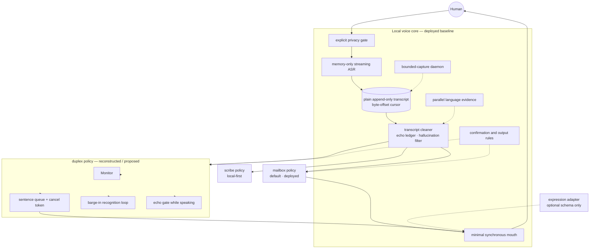
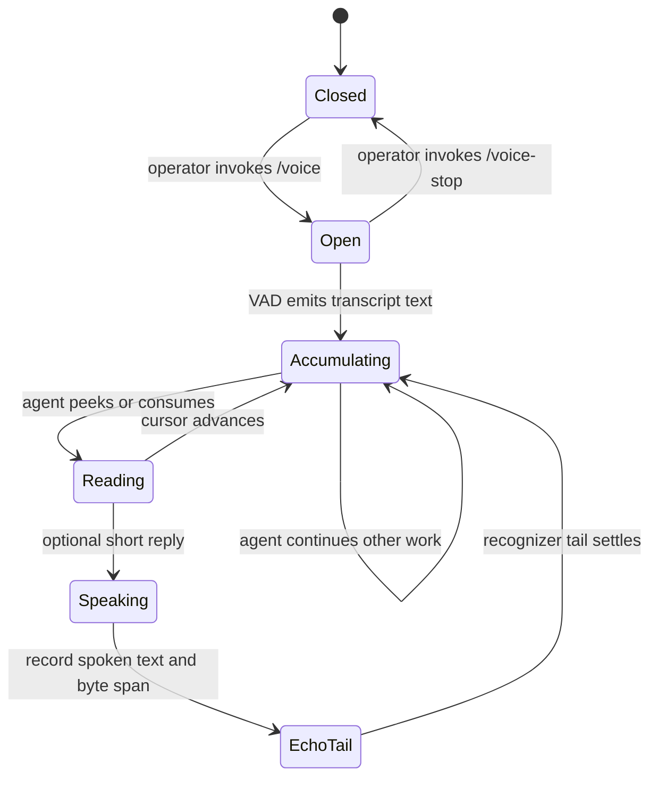
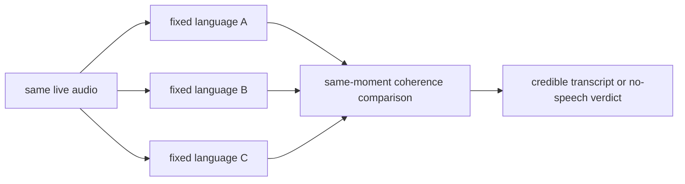
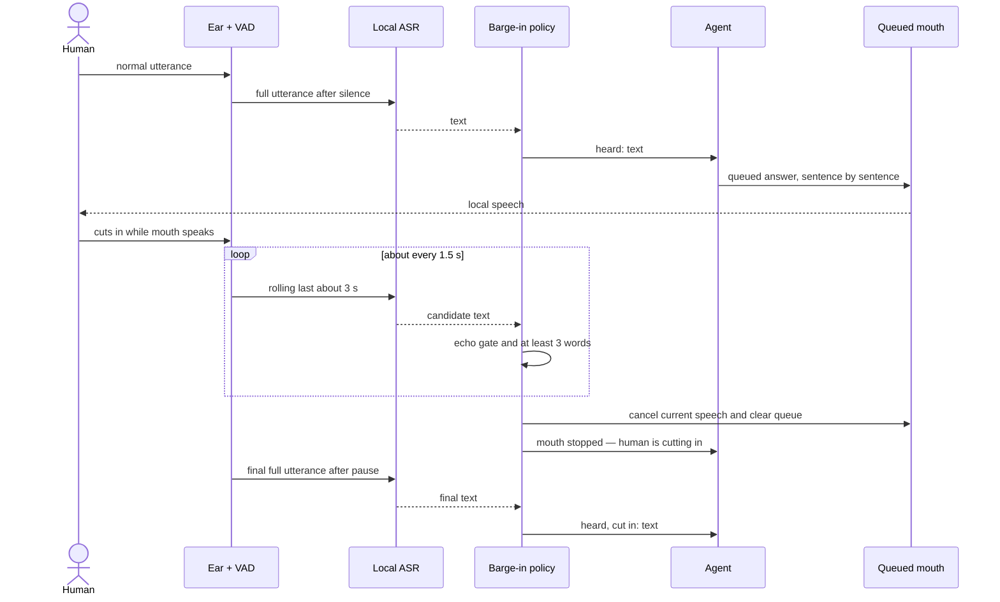

# `voice`: canonical architecture

> Borg agents family — humans communication skill: a local voice channel between humans and their agents. Ear and mouth are local; the text in between is the channel.

This document defines the public architecture of the `voice` skill. It separates a small deployed local core from interchangeable conversation policies. Claims are marked:

- **[deployed/measured]** observed in a running implementation or measured locally;
- **[reconstructed]** recovered from a rendered design whose original source was unavailable;
- **[proposed]** part of the public reference architecture, not yet shipped.

The default policy is `mailbox`. `duplex` is documented as an implementation target and must not be presented as shipped until its conformance tests pass.

## 1. Permission and human authority come first

The microphone opens only after an explicit operator action such as `/voice`. It never opens because an agent considers listening convenient. **[deployed/measured]**

Microphone permission belongs to a responsible OS application, not abstractly to a script. On macOS, a process launched from an authorized terminal may inherit a usable recording context; detached-start behavior varies and must be measured on the target system. A background process may also be unable to trigger a permission prompt. **[deployed/measured]**

For bounded captures, a terminal-born daemon can own permission and accept file-based requests from background clients. Each request specifies duration and capture parameters; the daemon caps duration, re-enumerates devices, writes the capture, and returns a result file. **[deployed/measured]**

Governance rules:

1. Restate recognized intent before acting; the operator cannot see what the recognizer produced.
2. A transcript is not authority for a destructive, irreversible, or outward-facing action. Confirm those actions in durable text.
3. Speak briefly; put paths, numbers, commands, choices, and full explanations in text.
4. Stopping the listener does not silently destroy unread transcript data.
5. Resolve input devices by stable name and display the resolved device.

## 2. Architecture boundary

The core ends where conversation policy begins.



The Monitor, interruptible mouth queue, barge-in loop, and echo decisions made during speech belong to `duplex`, not to the transport core. This keeps the default small and prevents every feature from becoming one inseparable state machine.

## 3. Local data boundary and egress

| Data | Default boundary |
|---|---|
| Live microphone audio | Process memory; streaming ASR emits text. **[deployed/measured]** |
| Bounded diagnostic/capture audio | Temporary or operator-selected local file with an explicit duration cap. **[deployed/measured]** |
| Transcript | Human-readable local plain file. The operator can inspect or delete it without a daemon. **[deployed/measured]** |
| Agent input | Cleaned transcript text only, and only when policy delivers it. **[deployed/measured]** |
| Spoken output | Text is synthesized locally; the complete answer remains durable text. **[deployed/measured]** |
| Scribe output | Local until explicitly read or shared. **[deployed/measured]** |

“Local model” does not prove “no network.” A local TTS runtime was observed initiating small outbound TLS traffic through native dependencies even when no application-level network call existed. Disabling library telemetry did not stop it. **[reconstructed]**

The public reference therefore runs the audio process tree under OS-enforced deny-by-default egress. File-only transports can deny all networking; a loopback ASR service may allow only localhost. Disabling this boundary must be explicit and visibly reported. **[proposed, informed by reconstructed verification]**

## 4. The mailbox policy: default

Mailbox removes coordination instead of managing it. The operator may speak while the agent works. Recognition appends text; the agent consumes new text on any turn. Neither side owns the other's turn. **[deployed/measured]**



### Inbox protocol

The transcript substrate is an append-only plain file plus a byte-offset read mark. Operations include:

- consume only new bytes;
- peek without advancing;
- inspect the full transcript;
- report listener, device, inbox, and unread status;
- clear logically while a writer is live; truncate only after the writer stops.

Truncating beneath an open append writer can leave a sparse/NUL-filled hole before new text. Readers must tolerate NUL runs, but the primary defense is logical clearing. **[deployed/measured]**

### Transcript cleaning

Before delivery, the reader:

- removes timestamps and explicit noise tokens;
- retains raw sound captions but does not attribute them to the human;
- rejects known silence hallucinations, including corpus-shaped subtitle credits and sign-offs;
- collapses growing VAD passes by retaining the longest form;
- removes the mouth's echo using transport spans first and semantic overlap second.

### Echo ledger

The mouth records the transcript byte offset before it speaks, waits for the delayed recognition tail, and records the final offset. The reader blanks complete intersecting lines. A measured `3.0 s` tail was insufficient; `4.5 s` succeeded in the deployed environment. **[deployed/measured baseline; tune per backend]**

Recent spoken text is also logged. An utterance with at least `0.6` word overlap with speech produced in the last `600 s` is rejected. This is a second layer: word matching alone cannot catch cross-language echo, where a fixed-language recognizer turns the mouth's speech into unrelated words. **[deployed/measured baseline]**

## 5. Language handling

Single-pass language auto-detection is not authoritative. Russian speech was measured as English at confidence `0.81`; room level distinguished speech from silence more reliably than the language label. **[deployed/measured]**

For mixed-language operation, fixed-language listeners may observe the same moment and write separate transcript jars. A reader compares the density of language-specific function words and selects the most coherent candidate. Scores are comparable only within the same moment, never across unrelated utterances. **[deployed/measured]**



Each active jar loads its own model and performs work on VAD triggers. Lazy activation is allowed, but routing must not trust one detector's label as ground truth. **[deployed cost; proposed optimization]**

Carrying recognition context between chunks may help steady speech and amplify an early error during drifting speech. It remains a switch until controlled comparison establishes a default. **[deployed observation]**

## 6. Scribe policy

Scribe is nearly free on the mailbox substrate: the inbox is already a local transcript with an explicit model-read boundary. **[deployed architecture]**

A meeting-oriented view may add timestamps, line counts, rotation, and detached lifecycle. Ordinary transcript lines do not enter an agent session unless the operator requests reading, summarization, or another operation. **[proposed presentation over deployed substrate]**

## 7. Duplex policy

Duplex is for low-latency live conversation in which the mouth may be speaking when the operator cuts in. It requires more state and is explicitly enabled. **[reconstructed / proposed]**



The algorithm preserves five separate decisions:

1. Rolling recognition examines approximately the last `3 s` every `1.5 s`.
2. Candidate text is compared with the mouth's own output.
3. A minimum content gate (shown as at least three words) avoids reacting to fragments.
4. A valid cut-in cancels current speech and clears queued speech.
5. The complete utterance is transcribed again after the operator's pause.

### Monitor

Duplex requires an observable Monitor showing at least:

- resolved input device and permission state;
- listening, transcribing, thinking, speaking, interrupted, and stopped states;
- the transcript the system believes it heard;
- mouth queue and cancel state;
- active privacy/egress boundary and errors.

The Monitor is optional for mailbox, whose deployed minimum is a resolved-device banner, status command, and human-readable inbox. **[reconstructed requirement; deployed mailbox minimum]**

## 8. Mouth and expression capabilities

The deployed baseline mouth is synchronous, brief, and selects a configured voice by language. It has no semantic emotion/prosody support. **[deployed/measured]**

The public schema may describe richer intent without pretending every backend supports it: **[proposed]**

```yaml
speech:
  text: "A short answer"
  lang: en
  voice: null
  style:
    emotion: warm
    intensity: 0.35
    pace: 0.95
  interruptible: true
```

Every backend reports which fields it applied, approximated, or ignored. A basic platform voice may apply only `voice` and `pace`; a richer backend may apply emotion and prosody. Persona profiles are reversible sets of conversation and voice overrides, not proof that emotion is implemented.

## 9. State signals and non-verbal input

Repeated sound patterns can communicate `busy`, `ready`, `ask`, `done`, and “an announcement follows” without requiring the operator to watch the screen. Pattern, count, and spacing carry meaning; events fire on state changes, not timers. **[deployed/measured]**

Buttons or keys may form a permission-free gesture lane. They must be modeled as events, not silently treated as transcript authority. A historical button-based turn-ending path was removed after proving broken; documentation and code must be tested together to prevent this kind of drift. **[deployed/measured]**

## 10. Baseline tuning values

These are measured starting points, not portable truths:

| Parameter | Baseline |
|---|---:|
| VAD threshold | `0.72` |
| Recognition chunk | `10 s` |
| Mouth recognition tail | `4.5 s` |
| Recent-spoken echo window | `600 s` |
| Semantic echo overlap | `0.60` |
| Room gate floor | `-70 dBFS` |
| Language-confidence diagnostic floor | `0.50` |
| Function-word coherence floor | `0.08` |
| Multi-press burst gap | `2.0 s` |

The previous `30 s` recognition chunk dominated round-trip delay. Any implementation should expose tuning and record why a default changed. **[deployed/measured]**

## 11. Conformance requirements

### Core and mailbox

- Microphone activation requires explicit operator action.
- Live streaming writes no audio file.
- Transcript is locally inspectable without a daemon.
- Consume and peek have deterministic cursor behavior.
- Clearing under a live writer creates no sparse/NUL corruption.
- Silence hallucinations, captions, rolling duplicates, same-language echo, and cross-language echo have fixtures.
- Resolved input device is visible.
- Audio process egress is denied by default and tested.
- Stop is idempotent and preserves unread transcript unless the operator explicitly deletes it.

### Duplex before it may ship

- Mouth output is queued in cancellable units.
- Cut-in latency, false interruption rate, and echo rejection are measured.
- Queue cancellation prevents stale speech from resuming.
- Final full-utterance transcription follows interruption detection.
- Monitor state matches the actual ear and mouth processes.
- Failure of Monitor, ASR, TTS, or session does not leave an unobservable live microphone.

## 12. Publication status

The mailbox architecture and its tuning baseline come from a deployed implementation. Duplex is a reconstructed design and proposed public policy. Expression is schema-only. All four Mermaid blocks were rendered successfully with Mermaid CLI `11.12.0`; publication automation should pin and repeat that check.

This document intentionally contains no machine-specific paths, hostnames, account names, device serials, or private rig internals. The repository currently uses a private remote as a staging area. Public visibility remains a separate operator-authorized step after sanitize, license, and release-readiness review.

